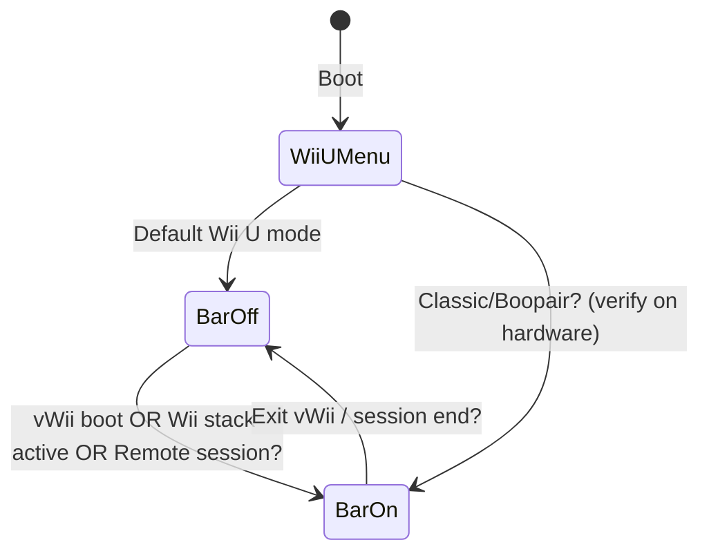

# Design — Rear-port sensor bar power on Wii U menu (Aroma)

**Version:** 0.3  
**Date:** Oct 16, 2026  
**Scope:** **Wired sensor bar on Wii U AV/red connector only.** Not GamePad IR. **No USB-powered bars.**

---

## 1. Problem statement

### Observed (Gregory)

- On **Wii U mode** (system menu), the **console sensor bar** (plugged into the **red port**) **does not light up**.
- It **does** light up when:
  - A **third-party controller** is connected (Classic / Pro / etc.), **or**
  - A controller is connected via **Boopair**, **or**
  - **vWii** is entered.

### Desired

- **v1:** Sensor bar **powered on Wii U main menu** so **Wii Remotes** can point at the **TV** without the above workarounds.
- **Later (optional):** Same in selected Wii U titles; not required for v1.

### Non-goals

- GamePad DRC sensor bar (**DRC Sensorbar plugin is irrelevant**).
- Replacing the bar with candles / DIY IR (except documented emergency fallback).
- vWii-only patches unless they help find the **console port** enable path.

---

## 2. Hardware — console sensor bar port

| Item | Detail |
|------|--------|
| Connector | Same **2-pin** plug as Wii — rear of Wii U (**red** port) |
| Pins | 1 = GND, 2 = **power** (nominal ~12 V rail, **~7–7.5 V under load** on many bars) |
| Bar itself | **No data** — only IR LEDs; Wii Remote sees the dots |
| Board testpoints (Wii U) | WiiUBrew hardware notes cite **TP31** (sensor bar GND PWM), **TP32** (12 V), **TP33** (sensor related) — useful for **hardware RE**, not for Gregory’s daily use |

**Verify power:** Dark room + **phone camera** on the **bar under the TV**. No glow = port not energized.

**Important:** Community reports often say the **external** bar needs a **synced Wii Remote** (or Wii stack active) before Nintendo turns it on — matches Gregory’s “works in vWii / with controller” story.

---

## 3. Why this is harder than “an Aroma plugin like DRC Sensorbar”

| | GamePad IR (DRC Sensorbar) | **This project (rear port)** |
|---|---------------------------|------------------------------|
| Controlled by | GamePad **VPAD** / GPIO docs (e.g. libdrc “sensor bar power”) | **Console** power switch / SMC–STM path to **AV port** |
| Public plugin | Yes (MIT) | **None found** (Oct 2026 search) |
| v1 approach | Install `.wps` | **Research + new WUPS plugin** (or IOSU patch module) |

**Feasibility:** **Plausible** — Nintendo clearly **can** enable the port (vWii, Remote sync flows). We need the **same enable signal** during **Wii U menu** foreground.

**Risk:** Enable path may live in **IOSU / MCP / STM** with no public API; plugin may need **kernel patch** (Aroma-style) not just a lightweight `.wps`.

---

## 4. Stock behavior (working theory)

**Confirmed (Gregory, Oct 16):** See `notes/baseline-hardware-tests.md` — menu **OFF**; BT controller / vWii / vWii Classic game **ON**.

### Other AI proposal (rejected for this hardware)

Scaffolding from **DRC-Sensorbar** + **`WPADSetSensorBarPower`** targets **GamePad IR** or nonexistent Wii U APIs — **not** the rear port. Details: `notes/other-ai-proposal-review.md`.

**Real scaffold:** `plugin/` → **ConsoleSensorBar** — menu title IDs, keep-alive timer, experimental `KPADInit` + future padscore RE.

---

## 5. Proposed software — `ConsoleSensorBar` (working name)

### 5.1 Type

**Aroma WUPS plugin** (`.wps`) — same delivery as other plugins:

`sd:/wiiu/environments/aroma/plugins/consolesensorbar.wps`

Optional later: **IOSU module** if userland cannot reach the power GPIO / SMC command.

### 5.2 Behavior (v1)

| State | Action |
|-------|--------|
| Wii U **system menu** in foreground | **Enable** rear-port sensor bar power |
| HOME overlay | TBD — may mirror Nintendo (bar off) or keep on; test after we find enable API |
| Fullscreen game / applet | **Off** (or config whitelist) — save power, match “menu only” ask |
| vWii | **Do not fight** stock (leave enabled) |

Config via WUPS: **L + D-Pad Down + Minus** — Mode: Menu only / Always when in Wii U OS / Disabled.

### 5.3 Implementation strategy (action phase — ordered)

| Step | Work | Output |
|------|------|--------|
| **R1** | On-console baseline tests (§4) | `baseline-hardware-tests.md` |
| **R2** | Diff behavior: menu vs vWii (same bar, phone camera) | Confirm **software** gate, not bad bar |
| **R3** | Search Aroma/iosu/wut trees + GBAtemp for `sensor`, `SENSOR`, `bar`, SMC, MCP, `0x1014` menu title | `notes/research-links.md` |
| **R4** | Trace what changes when Classic is plugged (IOSU log, known MCP hooks) | Hypothesis: which subsystem enables 12 V |
| **R5** | Minimal POC: call or patch **one** enable function on menu enter | `.wps` test build |
| **R6** | Title-ID gating (Wii U Menu only) | v1 feature complete |
| **R7** | README install + rollback (remove `.wps`) | Gregory-facing |

**Do not fork DRC Sensorbar** for core logic — wrong hardware. Only reuse **WUPS boilerplate** (Dockerfile, `main.cpp` skeleton) if helpful.

### 5.4 Toolchain

- [Aroma](https://wiiu-env.github.io/)
- [WUPS](https://github.com/wiiu-env/WiiUPluginSystem) + [wut](https://github.com/devkitPro/wut)
- Possibly [libmocha](https://github.com/wiiu-env/libmocha) if IOSU calls needed (see evWii pattern)
- Reference pattern: plugin loads in Wii U OS, hooks **foreground application** / **menu title ID**

### 5.5 Testing (Gregory)

| # | Test | Pass |
|---|------|------|
| T1 | Wii U menu, plugin on — **TV bar** IR visible on phone | Yes |
| T2 | Wii Remote — menu navigation | Pointer works toward TV |
| T3 | Launch game — menu-only mode turns bar off | Optional v1 |
| T4 | vWii — bar still works | No regression |
| T5 | Remove plugin — stock behavior returns | Yes |

---

## 6. If userland experiments fail

| Plan | What |
|------|------|
| **RE padscore / coreinit** | Find export that asserts rear 12 V (same path as vWii) |
| **IOSU / MCP patch** | GPIO / SMC path (TP31–TP33) — expert only |
| **“Fake” Wii session** | Mimic BT-controller connect side effects — risky |

USB / battery sensor bars are **out of project scope** (Gregory).

---

## 7. Project phases

### Phase 1 — Report (current)

- [x] Scope locked: **rear port only**
- [x] Design doc v0.2
- [ ] Gregory: baseline hardware tests (§4) when ready
- [ ] Short report section: problem + why no off-the-shelf plugin

### Phase 2 — Research (action start)

- [ ] `baseline-hardware-tests.md`
- [ ] Code search / community ask (Wii U env Discord, GBAtemp)
- [ ] Document candidate APIs or patch sites in `notes/research-findings.md`

### Phase 3 — POC plugin

- [ ] Repo under project `src/` or fork template
- [ ] `consolesensorbar.wps` — menu-only enable
- [ ] Install doc for SD path

### Phase 4 — Polish

- [ ] WUPS config, optional whitelist
- [ ] Link from `Wii U modding central` if you want

---

## 8. References

- [WiiUBrew — Sensor Bar](https://wiiubrew.org/wiki/Sensor_Bar) — same connector as Wii
- [ConsoleMods — Wii U sensor bar pinout](https://consolemods.org/wiki/WiiU:Connector_Pinouts)
- [GBAtemp — when does sensor bar power](https://gbatemp.net/threads/wii-u-sensor-bar-how-when-does-it-power.375282/)
- [evWii](https://github.com/GaryOderNichts/evwii) — example of patching **vWii setup from Wii U mode** (different feature, same *class* of approach)
- **Not used:** [DRC Sensorbar](https://github.com/WiiDatabase/DRC-Sensorbar) — GamePad only

---

## 9. Open questions (Gregory)

1. **Wii U Menu region** — USA / EUR / JPN? (plugin checks all three title IDs.)
2. **Aroma version** on the console?
3. After first test `.wps`: did **any** IR appear on the **rear** bar?

---

*Next: Phase 1 report from this doc; say **start action phase** for R1–R2 on hardware.*
